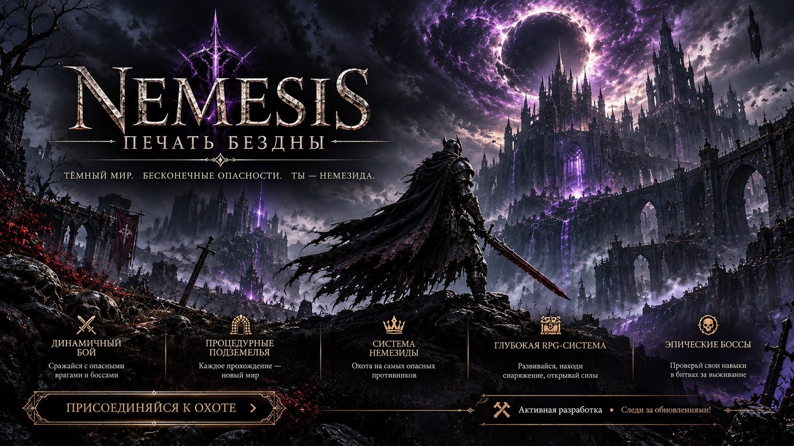

# NEMESIS: ПЕЧАТЬ БЕЗДНЫ

  

  **2D action-RPG на Unity 6 · вид сверху с изометрической раскладкой · тёмное фэнтези**

**«Печать бездны»** — игра об исследовании разрушенного мира, боях с порождениями Бездны и противниках, которые запоминают стиль игрока. Разработка ведётся на C# в Unity 6. Ранний прототип и часть механик проверялись на Roblox; Roblox больше не является целевой платформой.

## Визуальное направление

- Детализированный тёмный pixel art: чёрный камень, потёртый металл, пепел, багровые акценты и свет факелов.
- Камера строго 2D top-down с изометрической раскладкой.
- Туман войны скрывает неисследованные участки мира.
- Интерфейс на русском языке: тёмные панели, золотая отделка, карта, журнал и панель заданий.
- Движение окружения сдержанное: анимированы только отдельные источники огня и опасности, большинство декораций статичны.

## Что находится в Unity-проекте

Проект находится в каталоге Unity/.

- Две игровые сцены: **Пепельные окраины** и **Забытые катакомбы**.
- Изометрический мир на основе каменной брусчатки, потрескавшихся плит и лавовой кромки.
- Готические руины, собор, склеп, колонны, арки, железные двери, цепи, алтари и декор.
- Туман войны с исследованием территории и затемнением уже посещённых зон.
- Базовое управление, бег, ближняя атака, уклонение и взаимодействия с NPC, сундуком, святилищем и входом в подземелье.
- Противники и босс в стартовой локации.
- Русское главное меню, HUD, панель основного задания, карта, инвентарь, журнал охоты и настройки.
- Сдержанная анимация окружения: два факела, одна группа свечей, одна шиповая ловушка и одно заражённое растение; остальной декор статичен.
- Геройские направленные циклы Idle, Walk и Attack: четыре направления, по четыре кадра из набора 2DPIXX (CC BY 4.0). Получение урона и смерть пока используют процедурные реакции.

## Статус

Это **ранний играбельный срез**, а не законченная RPG. Две сцены и Windows x64-сборка формируются в Unity 6. В исходниках есть базовый игровой цикл, генерация подземелья, fog of war и интерфейс. При этом полноценный инвентарь с характеристиками предметов, сохранения, квестовая прогрессия, полноценная боевая система, звуковой дизайн, баланс и полное тестирование ещё впереди.

Статус проверяется отдельно для исходников, компиляции, сборки и поведения в запущенной игре. Наличие скрипта само по себе не считается подтверждением готовой функции.

## Открытие проекта

1. Установи Unity Hub и Unity **6000.0.85f2** с Windows Build Support.
2. В Unity Hub выбери **Add project from disk** и укажи каталог Unity/.
3. Дождись импорта пакетов и завершения компиляции.
4. Открой Assets/Nemesis/Scenes/AshenOutskirts.unity или AshenDungeon.unity.
5. Запусти сцену кнопкой **Play**.

Подробная инструкция: [Unity README](Unity/README.md). Лицензии и дополнительные наборы: [Asset Setup](Unity/ASSET_SETUP.md) и [Asset Credits](docs/ASSET_CREDITS.md).

## Управление

| Действие | Клавиши |
|---|---|
| Движение | WASD |
| Бег | Left Shift |
| Атака | ЛКМ / J |
| Уклонение | Space |
| Взаимодействие | E |
| Инвентарь | I |
| Персонаж | Tab |
| Доска охоты | B |
| Пауза / меню | Esc |

## Структура

- Unity/ — Unity 6 проект, сцены, C#-исходники, редакторские инструменты и разрешённые игровые ассеты.
- docs/ — дизайн-документы, технический статус, авторство ассетов и дорожная карта.
- nemesis-cover-fullhd.jpg — обложка проекта.

## Документы

- [Руководство Unity-проекта](Unity/README.md)
- [Установка и лицензии ассетов](Unity/ASSET_SETUP.md)
- [Авторство и лицензии](docs/ASSET_CREDITS.md)
- [Руководство игрока](docs/PLAYER_GUIDE.md)
- [Game Bible](docs/GAME_BIBLE.md)
- [Бестиарий](docs/BESTIARY.md)
- [Боевая система](docs/COMBAT_SYSTEM.md)
- [Система Немезиды](docs/NEMESIS_SYSTEM.md)
- [Мир и подземелья](docs/WORLD_AND_DUNGEONS.md)
- [Технический статус](docs/TECHNICAL_STATUS.md)
- [Дорожная карта](docs/ROADMAP.md)
- [История изменений](CHANGELOG.md)

---

  **НЕМЕЗИДА НЕ ЗАБЫВАЕТ.**

